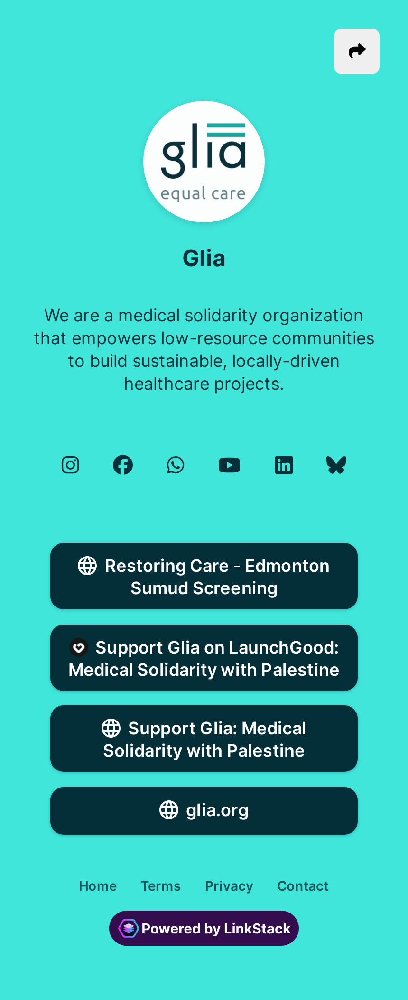

# LinkStack — https://link.glia.org

Infrastructure-as-code for Glia's self-hosted [LinkStack](https://linkstack.org) instance: the
link-in-bio page at `link.glia.org`, plus two local capabilities upstream does not have —
**LDAP login** against `auth.glia.org` and **page teams** (several people editing one page).

No secrets are committed. Passwords, tokens and pull-credentials live in the cluster or in
the operator's password manager.

## What runs where

| Piece | Value |
|---|---|
| Cluster / namespace | `do-tor1-k8s-glia1` / `linkstack` |
| App | LinkStack 4.8.8 (Laravel 9, PHP 8.3, Apache) |
| Image | `ghcr.io/gliax/linkstack:v4.8.8-ldap` (stock + `php83-ldap`) |
| Storage | PVC `linkstack-data`, 2 Gi, `do-block-storage`, mounted at `/htdocs` |
| Database | SQLite at `/htdocs/database/database.sqlite` |
| Exposure | nginx ingress, LB `159.203.50.191`, TLS from cert-manager (`letsencrypt-prod`) |
| DNS | Gandi LiveDNS `A link → 159.203.50.191` |

The app **code** lives on the PVC, not in the image: the image's `/htdocs` is only used to
seed an empty volume (the `seed` initContainer), so `v4.8.8-ldap` differs from stock only by
the PHP extension.

## The page



Mobile preview of the live page (desktop: `docs/preview-desktop.png`). The content mapping
from the old Linktree — title, bio, avatar, six social icons, four links, brand colours — is
documented in `docs/page-content.md`; it lives in the database, not in this repo.

## Layout

```
deploy/linkstack-cluster.yaml   kubectl manifests (namespace, PVC, deployment, service, ingress)
image/Dockerfile                derived LinkStack image adding php83-ldap
patches/                        local app patches: LDAP login, page teams
docs/ldap-and-teams.md          how those features work, what they block, upgrade procedure
docs/page-content.md            how the Glia page itself was mapped from the old Linktree
scripts/                        deploy, rebuild image, re-apply patches, smoke test
```

## Deploy

```bash
# once per namespace: registry pull secret (copied from the ldap namespace, holds creds)
kubectl get secret ghcr-pull -n ldap -o yaml \
  | sed 's/namespace: ldap/namespace: linkstack/' | kubectl apply -f -

./scripts/deploy.sh          # apply manifests and wait for the rollout
./scripts/reapply-patches.sh # install LDAP + team patches (first run and after upgrades)
./scripts/check.sh           # smoke test
```

`patches/apply.php` runs inside the pod and is idempotent: each step checks for its marker,
copies new files, patches upstream files in place and keeps backups in `/tmp/lnk-patch-backup/`.
A vanished upstream anchor is reported as `FAIL … (anchor not found)`, never silently skipped.

## Deliberate choices worth knowing

- **HTTPS to the pod, not HTTP.** LinkStack's `TrustProxies` declares no trusted proxies, so
  behind a plain-HTTP ingress it emits `http://` asset and form URLs and the UI breaks with
  mixed content. The ingress uses `backend-protocol: HTTPS`; Apache's self-signed cert is
  not verified (`proxy-ssl-verify: off`).
- **Seeding guard tests for `artisan`, not emptiness.** A fresh DigitalOcean volume already
  contains `lost+found`, so "is the directory empty" is the wrong question.
- **Probes hit `/login`.** The home page is ~244 KB and blew the default 1 s probe timeout;
  `/login` is small and always unauthenticated.
- **`strategy: Recreate`.** The volume is RWO, so a rollout briefly has no pods while the
  volume detaches — expect a short 503 during restarts, not an incident.
- **Pinned versions.** `v4.8.8-ldap` rather than `latest`, so a redeploy cannot silently
  change the app version.

## Upgrading LinkStack

LinkStack's own updater replaces `app/` and `resources/`, which removes the LDAP and team
patches (the DB table and env vars survive). Rebuild the image for the new tag and re-apply:

```bash
./scripts/rebuild-image.sh v4.8.9          # builds ghcr.io/gliax/linkstack:v4.8.9-ldap
# update image: in deploy/linkstack-cluster.yaml, then
./scripts/deploy.sh && ./scripts/reapply-patches.sh
```

See `docs/ldap-and-teams.md` for limits (no audit trail, admins bypass teams, any directory
user may sign up) and the verification recipe.
